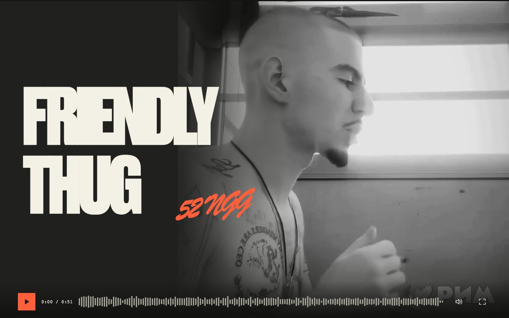

# Friendly Thug 52 NGG — «Что хотели»

[Смотреть эдит](https://manath-iq.github.io/hoteli/)

Фанатский эдит на 51 секунду. «Что хотели» — рабочее название по первой строке. Текст восстановлен по записи. Оранжевые слова появляются на акцентах читки. На упоминаниях Петербурга и океана в монтаж входят две сгенерированные чёрно-белые фотографии.

Клик по кадру или пробел ставит видео на паузу. По звуковой волне можно перематывать. Для локального просмотра запустите `python3 -m http.server 4173 --bind 127.0.0.1` из папки проекта и откройте `http://127.0.0.1:4173/`.

Статический сайт использует HTML, CSS и JavaScript. Таймкоды находятся в `lyrics.js`, данные звуковой волны — в `waveform.js`. Видео, фотографии и шрифты загружаются с самого сайта.
